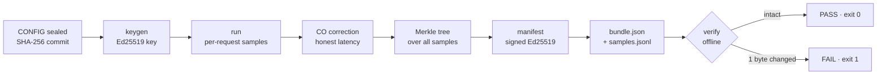

# VeriBench

**Verifiable load-test results — hand the judge a receipt, not a claim.**

`vpmp/v1` · built on the `stress-strike` engine · hand this sheet to a judge.

---

### The problem

Performance numbers decide money — capacity purchases, SLA acceptance, vendor
payment, regulatory evidence. Yet a load-test report is still accepted **on
faith**: there is no way to check that the raw data is intact, no way to know
who produced it, and no way to detect a fabricated test. Worse, standard
measurement quietly flatters the system: on a saturated server the generator
stops sending, so the slowest requests are never counted (coordinated omission).

**The buyer carries all the risk and holds none of the proof.**

---

### The solution

**VeriBench emits a measurement bundle that any third party can verify offline**
— trusting neither the tool nor the operator.



```
keygen ─────────────► run ─────────────► verify
seal the identity     measure + commit   7 checks, exit 0/1
                                        (CI-gateable)
```

---

### The three pillars

| Pillar | Mechanism | Question it answers |
|---|---|---|
| **1 · Attested Measurement (VPMP v1)** | Ed25519-signed manifest, raw sample stream locked behind a Merkle root, commit-then-reveal config binding | *Is this result intact, attributable, and consistent with its own raw data?* |
| **2 · Honest Latency** | Coordinated-omission correction over the raw stream, `co_extra_ns` auditable per request, bootstrap **95% CI**: `p99 = 41 ms [39–44 ms]` | *Is this number honest, and how sure are we?* |
| **3 · Adversarial-in-the-loop** | VeriGate adaptive difficulty → the **target** becomes an independent witness of the load actually delivered | *Did the load ever reach the target?* |

**Verification is offline and needs no key server:** format · key binding ·
Ed25519 signature · sample count · Merkle root · claim recomputation ·
per-sample consistency. Any failure → `FAIL`, exit `1`.

---

### What it does *not* do (stated plainly)

- A signature proves **integrity and attribution** — **not** that packets were
  sent. Fabrication by a non-colluding attacker is Pillar 3's job, and full
  per-request correspondence proof (nonce/ZK) is **[ROADMAP]**.
- No key-to-identity binding yet (PKI/CA step is a roadmap item).
- No server-side latency corroboration; the measurement is the client's view.

A dishonest operator must therefore sign their fake numbers at creation time —
which is exactly the act Pillar 3's outside witness is built to catch.

---

### Pricing model *(designed — not yet validated)*

| Tier | Price | For |
|---|---|---|
| Free / protocol | USD 0 — spec and reference `verify` open | Developers, CI, adoption of the verifier |
| Team | USD 99 / month | CI gates, team signing keys, retention |
| Business | USD 499 / month | Multiple teams, certificate issuance allowance |
| Enterprise self-hosted | USD 25k–75k / year | Regulated / air-gapped: evidence never leaves the perimeter |
| Certificate-as-a-Service | USD 0.50–2.00 per **verified report** | The neutral stamp: binds `key_id` + `scenario_hash` + Merkle root, anchored to a transparency log |

---

### Why now

SLAs-as-code and operational-resilience rules turned performance from folklore
into evidence. Signing and Merkle proofs now cost microseconds. And once anyone
can generate a plausible performance chart in seconds, **provable provenance
becomes the differentiator**.

### Competition (on verifiability, not throughput)

k6 Cloud · BlazeMeter · LoadRunner Cloud · Grafana Cloud k6 — all excellent
generators; **none** ships a signed, portable, offline-verifiable evidence
artifact, and none audits its coordinated-omission correction. Open-source
Locust/JMeter/Gatling share the same trust model.

### Status (honest)

Distributed generation, CO correction, VeriGate protection and a hash-chained
audit log ship today. The `vpmp/v1` bundle format, `keygen` / `verify` /
`run --emit-bundle` CLI surface, and the full verification algorithm (15 checks,
exit 0/1) are **implemented and shipping in v0.14.3**.
`./scripts/demo-verified.sh` demonstrates integrity → 1-byte tamper → detection.

---

**Contact**

> **[FILL IN]** — founder name · email · repository/docs URL

*Market figures referenced in the full pitch are labelled ESTIMATE and must be
re-verified. This sheet is not a certification, audit opinion, or legal
attestation.*
